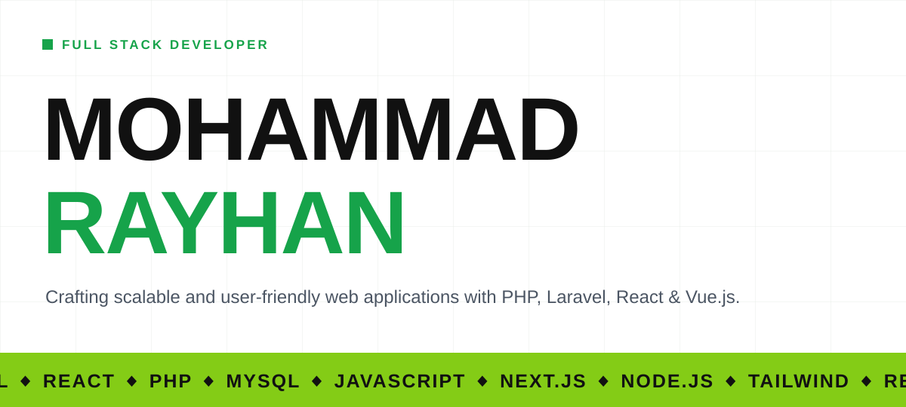

<!-- ============================================================ -->
<!--         Mohammad Rayhan — GitHub Profile README            -->
<!--   Bold editorial style — big type, numbered sections,      -->
<!--   green accent. One clean design for dark & light mode.    -->
<!-- ============================================================ -->

  
  
  

  

  
  
  
  

---

## 01 · ABOUT // who I am

**Full Stack Developer &amp; Software Engineer** working professionally on **production systems** — not tutorials. My core work is Laravel backends and REST APIs on one side, and fast, carefully-built React interfaces on the other, with MySQL underneath it all.

- ▶ Building &amp; maintaining real products: ISP billing, ERP platforms, e-commerce &amp; school management systems
- ▶ Shipping features people actually use, every day

| | |
| :--- | ---: |
| **ROLE** | Full Stack Developer |
| **FOCUS** | ISP Billing &amp; ERP Systems |
| **BASED** | Bangladesh |

---

## 02 · TECH STACK // what I use

  

| Area | Technologies |
| --- | --- |
| **Frontend** | HTML5, CSS3, JavaScript, React, Next.js, Vue.js, Tailwind CSS |
| **Backend** | PHP, Laravel, WordPress, MySQL, REST APIs |
| **Specialised** | MikroTik RouterOS API, bKash / Nagad payment gateways |
| **Tools** | Git, GitHub, VS Code, Docker |

---

## 03 · GITHUB STATS // numbers

  
  

  

---

## 04 · CONNECT // find me

  
  
  
  

<i>⚡ "First, solve the problem. Then, write the code."</i>

